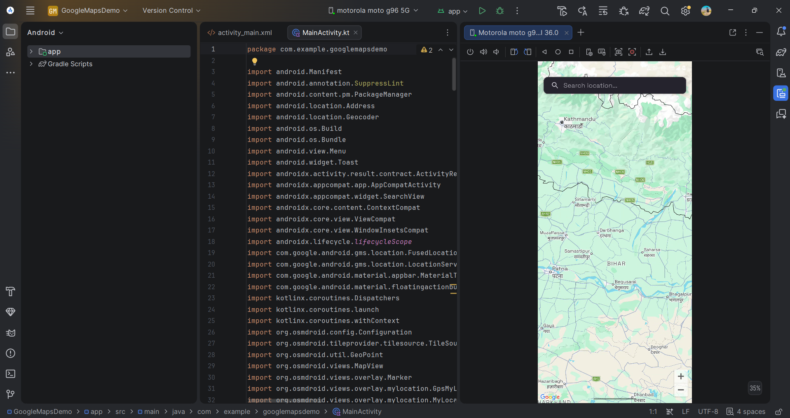
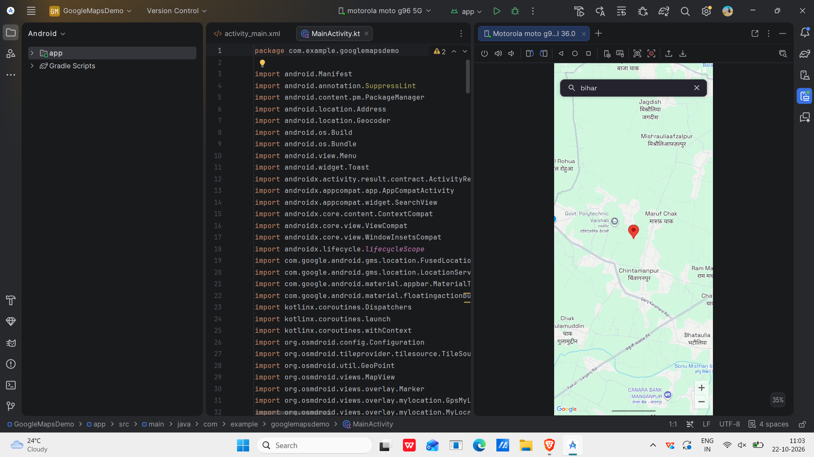
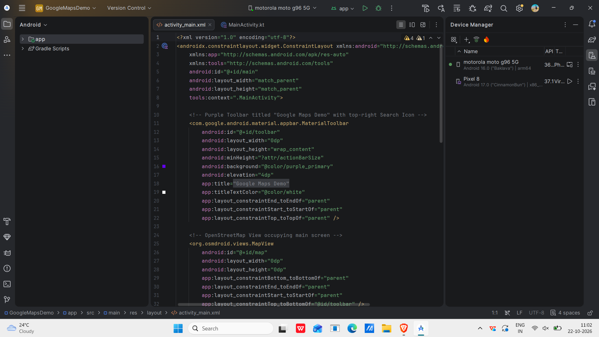
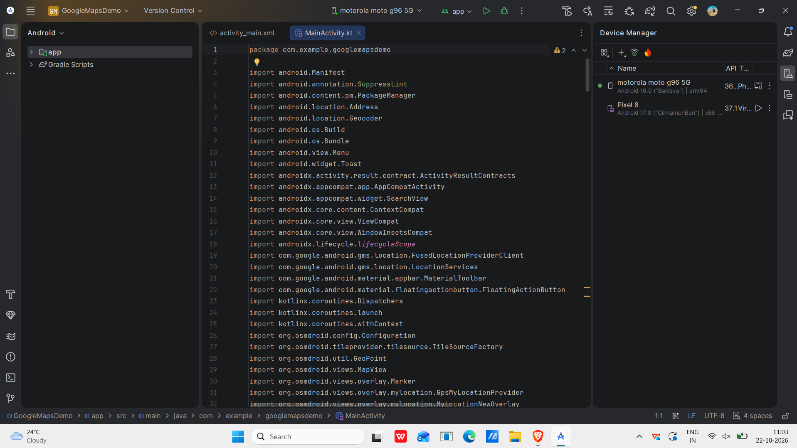

# Google Maps Demo Android Application

## 1. Experiment Title
**Develop an Application to Display a Map Using Google Maps API**

## 2. Aim
To develop an Android application that displays an interactive map and allows users to search for locations and navigate the map using zoom controls.

## 3. Concept and Technology
This experiment demonstrates how map-based services can be integrated into an Android application.

**Technologies used:**
- Android Studio
- Kotlin
- XML
- Android SDK
- osmdroid map library
- OpenStreetMap map data

**Note:** The current implementation uses osmdroid and OpenStreetMap, not the Google Maps SDK.

## 4. Scenario
A user wants to find a geographical location using a mobile application. The application displays a map, lets the user enter a location in the search bar, and shows the selected location on the map. The user can zoom in and out to explore the surrounding area.

## 5. Features
- Interactive map display
- Location search
- Map marker for a searched location
- Zoom-in and zoom-out controls
- Map navigation
- User-friendly search interface

## 6. Requirements

**Software requirements**
- Android Studio
- Android SDK
- Kotlin
- Android emulator or Android mobile device
- Internet connection

**Hardware requirements**
- Computer or laptop
- Android device or emulator

## 7. Procedure
1. Create a new Android project in Android Studio.
2. Configure the required dependencies for the map library.
3. Design the application interface using XML.
4. Implement the map display and location search in Kotlin.
5. Add a marker for the selected location.
6. Add zoom controls to the map.
7. Run the application on an emulator or Android device.
8. Test the map display, location search, and zoom controls.

## 8. Algorithm
1. Start the application.
2. Initialize the map.
3. Display the map on the screen.
4. Enter a location in the search bar.
5. Process the location search.
6. Move the map to the selected location and display a marker.
7. Use zoom controls to change the map scale.
8. Stop the application.

## 9. Screenshots and Output

### Screenshot 1: Main Map Screen


### Screenshot 2: Searching a Location


### Screenshot 3: XML Layout Design


### Screenshot 4: Kotlin Source Code


## 10. Test Cases

### Test Case 1: Map Display
**Test:** Launch the application.

**Expected output:** The map and search bar should appear on the screen.

**Actual output:** The map and search interface are displayed.

**Status:** Pass

### Test Case 2: Location Search
**Test:** Enter a location, such as Bihar, in the search bar.

**Expected output:** The map should move to the searched location and display a marker.

**Actual output:** The searched geographical area and marker are displayed.

**Status:** Pass

### Test Case 3: Zoom Controls
**Test:** Tap the zoom-in and zoom-out controls.

**Expected output:** The map should zoom in and out.

**Actual output:** The map provides zoom controls for exploring geographical areas.

**Status:** Pass

## 11. Student Details

- **Name:** Suvendu Mata
- **USN:** 25MCAR0136
- **Course:** Master of Computer Applications (MCA)
- **University:** JAIN (Deemed-to-be University), Bengaluru

## 12. Project Folder Structure

```text
GoogleMapsDemo/
├── app/
│   └── src/
│       └── main/
│           ├── java/
│           │   └── com/example/googlemapsdemo/
│           │       └── MainActivity.kt
│           ├── res/
│           │   └── layout/
│           │       └── activity_main.xml
│           └── AndroidManifest.xml
├── Screenshots/
│   ├── GoogleMapsDemo.png
│   ├── SearchLocation.png
│   ├── activity_main.png
│   └── MainActivity.png
├── build.gradle.kts
├── gradle.properties
├── settings.gradle.kts
└── README.md
```

## 13. How to Run the Project
1. Clone or download this repository.
2. Open the project in Android Studio.
3. Allow Gradle synchronization to finish.
4. Run the application on an Android device or emulator.
5. Test the map display, location search, and zoom controls.

## 14. Result
The Android application was executed successfully. It displays an interactive map and provides location search and zoom controls.


## Author
**Suvendu Mata**
